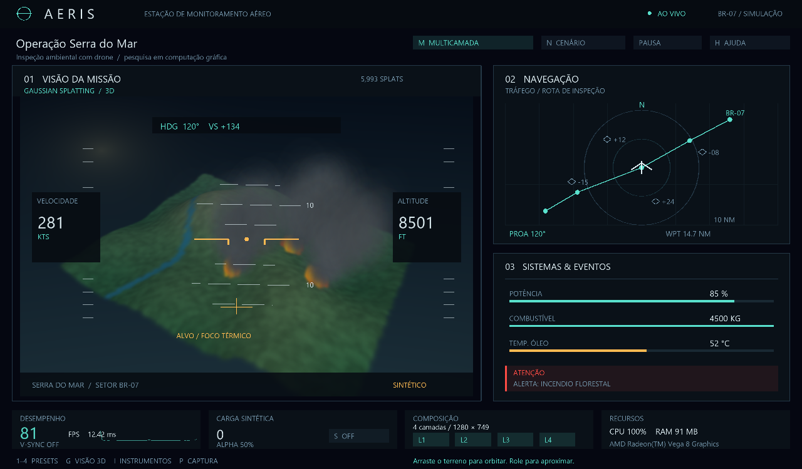

# AERIS — Monitoramento aéreo com Gaussian Splatting

**Matheus Della Rosa (RA 113209) · Guilherme Marolla Tesch (RA 113800)**  
Computação Gráfica e Visualização Científica · Eixo 1

Estação interativa de inspeção ambiental com drone: terreno 3D, rio, focos de incêndio e fumaça, mapa de navegação, instrumentos, alertas e telemetria. Compara composição **monolítica** e **multicamada** sobre a mesma cena, com um experimento reproduzível.



## Executar

Requer **Python 3.12 ou superior**, driver gráfico e suporte a **OpenGL 3.3**. As versões de bibliotecas validadas estão fixadas em `requirements.txt`.

```powershell
python -m venv .venv
.venv\Scripts\python -m pip install -r requirements.txt
.venv\Scripts\python main.py
```

Se as dependências já estiverem instaladas no Python do sistema, abra **iniciar.bat** ou execute `python main.py`. No primeiro uso, a compilação dos shaders e a geração do atlas de fontes podem levar alguns instantes. A janela se adapta à área disponível do monitor; o benchmark usa a resolução exata em buffers independentes.

## Controles

Os botões do painel também podem ser usados com o mouse. **H** abre a ajuda dentro da aplicação.

| Controle | Ação |
|---|---|
| Arrastar o terreno / rolar | Orbitar a câmera / aproximar e afastar |
| M | Alternar entre monolítica e multicamada |
| Espaço | Pausar ou continuar, inclusive a animação da fumaça |
| N | Alternar cenário normal, tráfego ou incêndio |
| G / I | Alternar Gaussianas 3D e horizonte / mostrar instrumentos |
| 1, 2, 3, 4 | Ativar a carga e aplicar C1, C2, C3 ou C4 |
| S / ↑ / ↓ | Ativar carga sintética / aumentar ou diminuir 5.000 retângulos |
| C | Alternar 2 e 4 camadas físicas |
| F1–F4 | Mostrar ou ocultar cada camada física |
| T | Alternar 0%, 50% e 80% de retângulos transparentes |
| V / R | Alternar V-Sync / resolução solicitada 720p e 1080p |
| Home | Reiniciar simulação e câmera com a mesma semente |
| P | Salvar imagem PNG e estado JSON em `capturas/` |
| Esc | Fechar ajuda; pressionar novamente para sair |

A apresentação inicia com a carga sintética desligada para facilitar a exploração da missão. Cada preset experimental ativa a carga. O número exibido no painel de carga se refere a **retângulos adicionais**, separado das **6.000 Gaussianas 3D** do terreno, fogo e fumaça.

## O que foi implementado

- Projeção perspectiva de centros 3D e covariâncias anisotrópicas, com Jacobiana: `Σ₂ᴅ = J R Σ₃ᴅ Rᵀ Jᵀ`.
- Descarte por planos near/far e suporte da elipse no frustum; ordenação estável do fundo para a frente.
- Rasterização de Gaussianas por quads instanciados e avaliação exponencial no fragment shader.
- Cache da projeção e dos autovetores de componentes estáticos. Apenas a fumaça precisa de nova projeção durante a animação; câmera e resolução invalidam o cache.
- Composição com alpha pré-multiplicado em todos os passes, preservando transparência e ordem de textos e formas.
- Recursos GPU persistentes, buffers com crescimento automático, atlas com acentos e liberação explícita.
- Simulação e geração de geometria com sementes locais, sem perturbar o gerador aleatório global.
- Controles de teclado e mouse, métricas reais, histórico do tempo por frame e capturas com metadados.

As Gaussianas são **procedurais**, sem treinamento com fotografias ou harmônicos esféricos. O objetivo é estudar projeção, ordenação, rasterização e composição. O cenário de estação terrestre para inspeção de incêndios adapta a organização por subsistemas do artigo de composição para uma aplicação distinta do cockpit embarcado.

## Benchmark reproduzível

```powershell
python benchmark.py
# Equivalente:
python main.py --benchmark
```

O padrão executa três repetições, com 60 frames de aquecimento descartados e 300 frames medidos por repetição. O cenário é incêndio, com 6.000 Gaussianas e semente 42. A ordem das estratégias se alterna entre repetições e configurações.

| Configuração | Retângulos adicionais | Camadas físicas | Resolução exata |
|---|---:|---:|---|
| C1 | 1.000 | 2 | 1280 × 720 |
| C2 | 10.000 | 2 | 1280 × 720 |
| C3 | 50.000 | 4 | 1280 × 720 |
| C4 | 100.000 | 4 | 1920 × 1080 |

Essa matriz é uma escolha experimental do projeto; o enunciado não prescreve esses valores. Em duas camadas, terreno e navegação são agrupados; instrumentos e alertas formam a outra camada. A quantidade e a ordem de conteúdo permanecem iguais entre estratégias.

```powershell
# Execução rápida de conferência:
python benchmark.py --warmup 5 --frames 20 --repeticoes 1 --configs C1

# Coleta realizada para a documentação desta versão:
python benchmark.py --warmup 60 --frames 180 --repeticoes 3 --cenario incendio --gaussianas 6000

# Variar a complexidade 3D separadamente da carga de composição:
python benchmark.py --configs C1 --gaussianas 12000 --cenario incendio

# Captura sem manter uma janela aberta:
python main.py --oculto --frames 30 --captura capturas/exemplo.png
```

Cada execução cria uma pasta exclusiva em `resultados/execucao_.../`, contendo:

- `resultados_benchmark.csv`: uma linha para cada repetição.
- `resumo_agregado.csv` e `resumo.json`: estatísticas de todas as repetições agrupadas.
- `amostras_frames.csv`: cada tempo medido, identificado por configuração, estratégia, repetição e frame.
- `amostras_recursos.csv`: amostragem de CPU e memória RSS.
- `metadados.json`: ambiente, GPU, driver, bibliotecas, parâmetros e ordem das execuções.
- `relatorio_experimental.md`: interpretação baseada nos valores efetivamente medidos.
- `graficos/`: comparativos de FPS, latência, distribuição e recursos.
- `capturas/`: imagens equivalentes dos dois modos para cada configuração.

O tempo medido inclui **preparação CPU, submissão e conclusão GPU** (`finish`), em RGBA8 offscreen idêntico nos dois modos. Não inclui troca da janela ou a atualização do simulador, que é pré-calculada com passo fixo de 1/60 s. O FPS do painel interativo inclui apresentação e pode ser limitado pelo V-Sync; não deve ser comparado diretamente ao benchmark. P95, P99 e máximo observado descrevem a amostra; não representam garantia de pior caso. Uso de CPU segue a convenção do processo e pode ultrapassar 100% em mais de um núcleo. VRAM total do processo não é medida.

Os arquivos que já existiam diretamente em `resultados/` foram preservados como histórico da implementação anterior. Use a coleta identificada em [validação](docs/validacao.md) para esta versão.

## Estrutura e validação

| Arquivo | Responsabilidade |
|---|---|
| `simulador.py` | Dados determinísticos, cenários, tempo e alertas |
| `gaussianas.py` | Cena procedural, projeção 3D, cache, ordenação e rasterização |
| `representacao.py` | Painéis, instrumentos, navegação e carga de retângulos |
| `renderizador.py` | Lotes de primitivas, shaders e atlas de fontes |
| `compositor.py` | Texturas RGBA8 e composição ordenada de FBOs |
| `pipeline.py` | Caminho comum das duas estratégias |
| `configuracoes.py` | Matriz única compartilhada por aplicação e experimentos |
| `main.py` | Janela, controles, telemetria e capturas |
| `benchmark.py` | Coleta, estatística, exportação e gráficos |
| `testes/` | Testes numéricos e verificação de pixels com OpenGL real |

```powershell
python -m unittest discover -s testes -v
```

Os testes GPU abrem janelas invisíveis e exigem o mesmo suporte OpenGL da aplicação. Eles verificam transparência, equivalência de pixels, visibilidade, fontes, redimensionamento e crescimento/liberação de buffers. Os testes CPU verificam projeção, perspectiva, ordenação, cache, simulação, carga exata e exportação estatística. Os testes comparam o cache à projeção integral, incluindo mudanças de câmera e resolução.

## Material do trabalho

- [Revisão bibliográfica e fontes primárias](docs/revisao_bibliografica.md)
- [Correspondência com o enunciado](docs/atendimento_enunciado.md)
- [Resultados e validação desta versão](docs/validacao.md)
- [Roteiro de demonstração em cinco minutos](docs/roteiro_apresentacao.md)
- [Artigo em formato IEEE, fonte editável](docs/artigo/main.tex)
- [Artigo em PDF, quatro páginas](output/pdf/AERIS_artigo.pdf)
- [Fontes do artigo para importar no Overleaf](docs/artigo-fontes.zip)

Protótipo acadêmico com dados sintéticos. A separação em FBOs é gráfica; não implementa isolamento de processos de um RTOS ou certificação aeronáutica.
