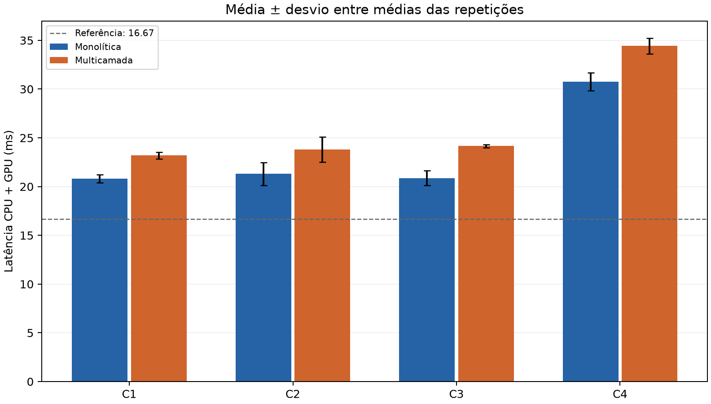

# Validação da versão AERIS

Coleta realizada em **21/10/2026, a partir de 00:04, horário de São Paulo**, em Windows 10, Python 3.14.7 e AMD Radeon Vega 8 com OpenGL 3.3.

## Resultado da coleta

- 4 configurações × 2 estratégias × 3 repetições.
- 60 quadros descartados e 180 medidos por repetição: **4.320 amostras válidas**, além de 1.440 quadros de aquecimento.
- Cenário incêndio, 6.000 Gaussianas 3D, semente 42, 50% dos retângulos transparentes.
- Buffers RGBA8 offscreen nas dimensões exatas dos presets.
- Sem substituição dos resultados antigos.

| Configuração | Modo | Média (ms) | P99 (ms) | FPS |
|---|---|---:|---:|---:|
| C1 | Monolítica | 20.828 | 28.382 | 48.01 |
| C1 | Multicamada | 23.187 | 31.709 | 43.13 |
| C2 | Monolítica | 21.305 | 30.678 | 46.94 |
| C2 | Multicamada | 23.808 | 35.086 | 42.00 |
| C3 | Monolítica | 20.873 | 27.574 | 47.91 |
| C3 | Multicamada | 24.157 | 27.742 | 41.40 |
| C4 | Monolítica | 30.756 | 47.631 | 32.51 |
| C4 | Multicamada | 34.426 | 45.084 | 29.05 |

A composição multicamada apresentou maior latência média nos quatro presets. Em C4, o P99 multicamada foi menor nesta amostra, mostrando por que média e cauda precisam ser analisadas separadamente. Todos os quadros medidos excederam 16,67 ms; a execução não atingiu 60 FPS sincronizados com essa carga. As conclusões se restringem ao ambiente e ao protocolo registrados.

Aproximadamente 31,64 MiB correspondem somente às quatro texturas RGBA8 intermediárias de C4. A memória RSS do relatório representa o processo completo e não mede VRAM.

## Dados auditáveis

- [relatorio_experimental.md](../resultados/execucao_20261021T030448Z_7e3fc562/relatorio_experimental.md)
- [resumo_agregado.csv](../resultados/execucao_20261021T030448Z_7e3fc562/resumo_agregado.csv)
- [resultados_benchmark.csv](../resultados/execucao_20261021T030448Z_7e3fc562/resultados_benchmark.csv)
- [amostras_frames.csv](../resultados/execucao_20261021T030448Z_7e3fc562/amostras_frames.csv)
- [amostras_recursos.csv](../resultados/execucao_20261021T030448Z_7e3fc562/amostras_recursos.csv)
- [metadados.json](../resultados/execucao_20261021T030448Z_7e3fc562/metadados.json)
- [resumo.json](../resultados/execucao_20261021T030448Z_7e3fc562/resumo.json)



## Verificação funcional

**59 testes aprovados** na verificação final, com OpenGL real. Também foram conferidos os controles de cenário, ajuda, horizonte, preset C4, redimensionamento, captura PNG/JSON e a entrada de benchmark pelo aplicativo.

A suíte final verifica estatística, exportação, cargas exatas, sementes locais, simulação e pausa, projeção, descarte, ordenação, cache e transparência. Os testes com OpenGL real comparam as duas estratégias, incluindo cenários completos, fontes, camadas ocultas, redimensionamento e liberação de recursos.

A tolerância das imagens RGBA8 considera a quantização dos passes intermediários: erro máximo de 3 níveis em 255, percentil 99 até 2 e média abaixo de 0,5 nível. Na medição de integração inicial, o máximo observado foi 2 níveis, com média máxima próxima de 0,012. A suíte deve ser repetida no computador de apresentação:

```powershell
python -m unittest discover -s testes -v
```

Confira o registro final em `testes/ultimo_resultado.txt`. As capturas da aplicação têm PNG e estado JSON; o benchmark preserva oito capturas nas resoluções exatas, permitindo inspeção visual independente.
